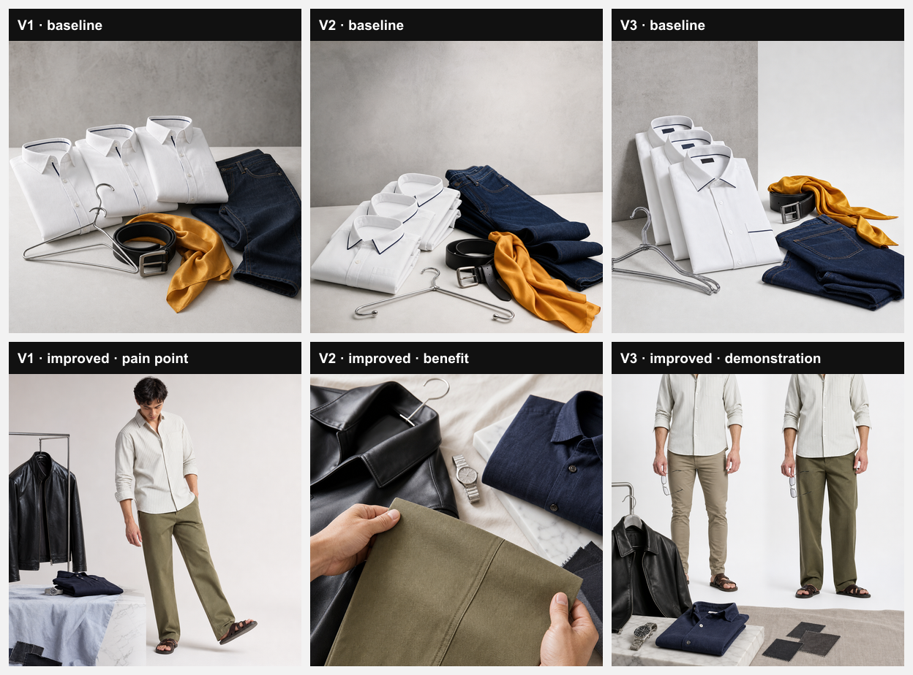

# Ad comparison: baseline vs improved

Brand SNITCH · product Olive Straight Fit Chinos (130d6580-f9f8-48f1-9b02-afbe33aae7b6) · scene white_studio · format square · no on-image text typed

## Improved: ad brief
- **Audience:** Modern Indian men 18-35 who want breathable, stylish trousers for work and play
- **Desired action:** Shop Now · **Funnel stage:** consideration
- **Value proposition:** Breathable cotton chinos that blend comfort with effortless style
- **Offer:** none · **Proof:** none

## Variations
| # | Baseline | Improved angle | Hypothesis | Headline (on-image text) | Primary text | CTA | Visual brief | Product reference used |
|---|---|---|---|---|---|---|---|---|
| 1 | shared scene prompt, no copy | pain_point | Men avoid chinos that feel stiff; showing real comfort will trigger a click | Stiff pants? Not anymore | Say goodbye to cramped legs. Our olive cotton chinos give you breathable freedom all day. | Shop Now | product_scene: A young man standing on a breezy street, one leg slightly lifted, the olive chinos clearly visible, camera at waist level showing the straight fit. | baseline y / improved y |
| 2 | shared scene prompt, no copy | benefit | Highlighting versatility for casual outings and office wear will attract style‑focused shoppers | From cafe to boardroom | Olive straight‑fit chinos transition effortlessly—casual brunch or relaxed office, always on point. | Shop Now | detail_closeup: Close‑up of the chinos’ cotton weave and straight‑leg seam, held by a hand, background softly blurred to emphasize texture. | baseline y / improved y |
| 3 | shared scene prompt, no copy | demonstration | Seeing the straight fit in action proves the silhouette is flattering and comfortable | Fits like it’s made for you | Watch the chinos drape perfectly on a modern fit—no bunching, pure comfort. | Shop Now | before_after: Split frame: left side a model in tight, uncomfortable trousers; right side the same model in olive chinos standing tall, showcasing the straight fit. | baseline y / improved y |

**Baseline scene prompt (same for all 3):** Three crisp white button‑down shirts with subtle navy piping, each folded neatly beside a polished chrome hanger, accompanied by a matte black leather belt with a brushed silver buckle, a pair of dark indigo slim‑fit jeans folded in a casual cascade, and a single vibrant saffron silk scarf loosely draped over the belt; all placed on a seamless white studio floor with a smooth concrete slab backdrop, illuminated by a soft, even white key light from a large softbox to the left creating gentle, shadowless illumination and a faint rim light from a subtle back‑light to give subtle depth, composition centered for a square frame with clear, uncluttered negative space on the upper right edge for a headline overlay, photorealistic studio product style with shallow depth of field blurring the distant floor, no text, logos, watermarks, or distorted hands appearing anywhere.

## Ad copy text format (ad_copy)
| | Baseline | Improved |
|---|---|---|
| Angle | — | benefit |
| Headline | Olive Chinos: Cool Comfort | Olive Chinos: Comfort Meets Style |
| Primary text | Breathe easy, look sharp—olive chinos for any vibe. Grab yours now! | 100% cotton, breathable fit that slides from coffee runs to office meetings. Grab yours now! |
| Description | 100% cotton, straight fit, ready for work or play. | Effortless elegance for every casual or work day. |
| CTA | Shop Now | Shop Now |
| Ad brief | — | {"audience":"Modern Indian men aged 18-35 who want versatile, comfortable trousers","desired_action":"Click to shop the chinos","funnel_stage":"consideration","value_proposition":"Breathable cotton comfort with stylish straight fit for any occasion","offer":null,"proof":null} |

## Runs
### Baseline (a12fec2)
- Models: scenePromptWriter = openai/gpt-oss-120b, image = gpt-image-2, adCopy = openai/gpt-oss-120b
- Total cost: $0.192697 (images $0.19236, ad copy $0.000337; scene prompt not priced)
- Total latency: 126.1 s (sequential)
- Errors: 0

### Improved (main 2404015)
- Models: scenePromptWriter = openai/gpt-oss-120b, image = gpt-image-2, adCopy = openai/gpt-oss-120b, strategy = openai/gpt-oss-120b
- Total cost: $0.194261 (strategy $0.001, images $0.19282, ad copy $0.000441; scene prompt not priced)
- Total latency: 109.5 s (sequential)
- Errors: 0

Harness note: the product reference is the product's own photo URL (the app first runs it through remove.bg and re-uploads the cutout); images are raw backgrounds without AdMaker's client-side text overlay.

## Brand state at improved run time
- Active lessons: unknown -- brand_lessons not readable (Could not find the table 'public.brand_lessons' in the schema cache) -- migration 059 not run, so no lessons could be used
- Brand Brain data: none
