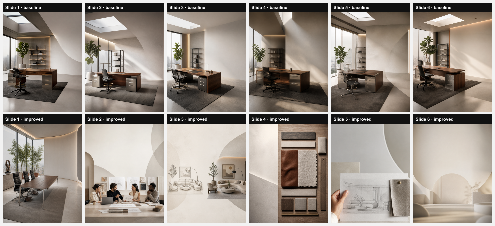

# Carousel comparison: baseline vs improved

Brand Creon Systems (ae6456b1-6e4f-4c82-8073-570c0b6c9449) · topic "From sketch to finished office lounge: our design process" · 6 slides · vibe none

| Slide | Baseline headline + points | Improved role + headline + points | Improved visual kind + must_show | Product reference used |
|---|---|---|---|---|
| 1 | **From Sketch to Signature Office Lounge** | *hook* **From Sketch to Finished Office Lounge** | **sketch_or_drawing**: A designer’s hand drawing a lounge layout on tracing paper, with nearby fabric swatches and a laptop screen displaying a 3D model, captured from a slightly elevated angle | baseline n / improved n |
| 2 | **Every lounge starts with a precise sketch** | *problem* **A vague brief leads to costly revisions** | **process_sequence**: A conference table with scattered notes, an open laptop, and a coffee cup, showing a team discussion with sketches pinned on the wall | baseline n / improved n |
| 3 | **Concept vs. Reality** Concept: hand drawn layout, ideas on paper Reality: 3D model, material selection, lighting plan | *step* **Sketch vs 3D Render** Hand sketch captures intent quickly Digital render adds material realism | **side_by_side**: Left side: a hand‑drawn lounge sketch on paper; right side: a high‑resolution 3D rendering of the same layout with lighting and textures | baseline n / improved n |
| 4 | **How do we ensure functional flow?** We map movement paths and ergonomics before any cut | *evidence* **What material choice defines office comfort?** Custom upholstered lounge seats in breathable leather suited for Delhi’s climate | **material_swatches**: A close‑up of a rich leather swatch beside a fabric sample, with a ruler for scale, laid on a wooden desk | baseline n / improved n |
| 5 | **Final touches that define the lounge** Custom furniture crafted to brand palette Acoustic panels installed for quiet work Smart lighting programmed for mood and productivity | *takeaway* **Three checkpoints before final build** Confirm dimensions against floor plan Approve finish samples Schedule on‑site installation | **detail_closeup**: A designer’s hand holding a blueprint, with a leather sample pinned beside it, captured in tight focus | baseline n / improved n |
| 6 | **Ready for a bespoke office lounge** | *cta* **Ready to see your lounge come alive?** | **abstract_mood**: A softly lit, out‑of‑focus office lounge with blurred furniture silhouettes, conveying a sense of completed design | baseline n / improved n |

## Runs
### Baseline (cfcd6c6)
- Models: carouselCopy = openai/gpt-oss-120b, imagePromptWriter = openai/gpt-oss-120b, image = gpt-image-2, imageQuality = low
- Total cost: $0.046503 (copy $0.001463, images $0.04504; prompt writer not priced)
- Total latency: 96.8 s (sequential; copy 4.6 s, prompt writer 1.2 s, images 91.0 s)
- Errors: 0

### Improved (main 2404015)
- Models: carouselCopy = openai/gpt-oss-120b, imagePromptWriter = openai/gpt-oss-120b, image = gpt-image-2, imageQuality = low
- Total cost: $0.043273 (copy $0.002133, images $0.04114; prompt writer not priced)
- Total latency: 93.7 s (sequential; copy 6.1 s, prompt writer 1.2 s, images 86.5 s)
- Errors: 0

## Improved narrative plan
- **Audience question:** How does Creon turn a rough sketch into a refined office lounge for Delhi NCR workplaces?
- **Takeaway:** Start the design early with Creon to map each stage from concept to finish and avoid costly revisions.
  1. *hook* — Most clients underestimate the steps between sketch and final lounge
  2. *problem* — A vague brief creates hidden design gaps that later cost time and money
  3. *step* — We translate hand sketches into precise 3D renders to lock material decisions
  4. *evidence* — Material selection based on Delhi climate ensures lasting comfort
  5. *takeaway* — Three checkpoints guarantee a smooth handover from design to build
  6. *cta* — Contact Creon now to begin the lounge transformation

Product reference: neither run had a product selected, so no slide used one.

## Brand state at improved run time
- Active lessons: unknown -- brand_lessons not readable (Could not find the table 'public.brand_lessons' in the schema cache) -- migration 059 not run, so no lessons could be used
- Brand Brain data: none
