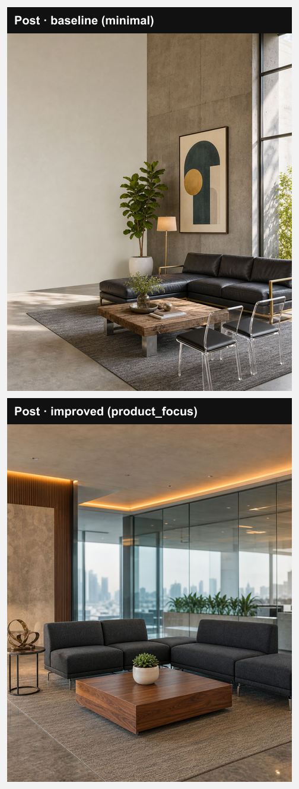

# Post comparison: baseline vs improved

Brand Creon Systems (ae6456b1-6e4f-4c82-8073-570c0b6c9449) · topic "Inside the custom lounge corner we designed for a client's office" · 4:5 · editorial_graphic · no product

| | Baseline (02d61d2) | Improved (main 2404015) |
|---|---|---|
| Post plan: message | (no plan -- not part of this pipeline) | Showcase the bespoke lounge corner that turns a corporate space into a personal retreat. |
| Post plan: audience reason | — | Office managers and business owners in Delhi NCR want workspaces that boost morale and reflect brand personality. |
| Hook | Ever imagined working inside a private lounge? | Ever walked into a room that feels personal? |
| Overlay text | (none) | (none) |
| Caption | Ever imagined working inside a private lounge? Step into the custom corner we crafted for a forward‑thinking office in Delhi NCR – sleek lines, plush seating, and acoustic panels that hush the hustle. Every detail, from the matte‑black coffee table to the ambient LED strip, is measured to boost focus and spark conversation. Feel the shift when you close the door: productivity lifts, stress drops, and the space feels unmistakably yours. Link in bio 👇 @creonsystems | Ever walked into a room that feels personal? We transformed a standard office nook into a custom lounge where comfort meets precision, soft modular sofas, muted earth tones, and subtle lighting that invites collaboration and quiet focus alike. Every detail, from the handcrafted walnut coffee table to the acoustic panels, was measured to the client’s workflow, turning everyday meetings into a refreshed experience. Ready to give your team a space they’ll actually look forward to? Link in bio 👇 @creonsystems |
| Template | minimal | product_focus |
| Visual brief | (none) | **product_scene**: A sleek, custom lounge corner in a modern office: modular low-back sofas in charcoal fabric, a polished walnut coffee table with a small succulent, recessed warm LED lighting, and a backdrop of glass partitions showing city views, captured from a slight angle that highlights depth. (Subject centered with the lounge occupying the middle third; left side slightly busier, right side kept calm for potential text overlay.) |
| Image prompt seed (writer rawInput) | Inside the custom lounge corner we designed for a client's office | Inside the custom lounge corner we designed for a client's office |
| Image prompt (writer output) | A sleek custom lounge corner featuring a low-profile, charcoal leather sectional sofa with polished brass armrests, a rectangular reclaimed‑oak coffee table with brushed steel legs, and a pair of transparent acrylic side chairs in matte black, all arranged on a muted slate‑gray woven rug; beside the seating, a tall indoor fiddle leaf fig in a white ceramic pot, a brushed‑nickel floor lamp with a warm amber shade, and a framed abstract geometric print in muted teal and gold on the exposed concrete wall, bathed in soft natural daylight filtered through floor‑to‑ceiling glass panels, casting gentle shadows; composition is vertical, leaving ample uncluttered space on the left side of the frame for a headline, rendered in a refined editorial graphic style, without any text, logos, watermarks, or distorted hands. | A sleek custom lounge corner in a modern Delhi office featuring a pair of low‑back modular sofas upholstered in deep charcoal woven fabric, each with brushed steel legs, centered around a polished walnut coffee table with a smooth grain finish that holds a single potted jade succulent in a matte white pot; recessed warm LED strip lighting runs along the ceiling edge casting a soft amber glow, while floor‑to‑ceiling glass partitions in the background reveal a faint silhouette of the city skyline; the scene is captured from a slight diagonal angle that emphasizes depth, with the lounge occupying the middle third of the frame, the left side subtly populated by a minimalist metal side table and a decorative abstract sculpture, and the right side left open and calm for future headline placement; rendered in a photorealistic editorial graphic style with shallow depth of field that softly blurs the distant view, no text, logos, watermarks, or distorted hands anywhere in the image. |
| Final image prompt sent | A sleek custom lounge corner featuring a low-profile, charcoal leather sectional sofa with polished brass armrests, a rectangular reclaimed‑oak coffee table with brushed steel legs, and a pair of transparent acrylic side chairs in matte black, all arranged on a muted slate‑gray woven rug; beside the seating, a tall indoor fiddle leaf fig in a white ceramic pot, a brushed‑nickel floor lamp with a warm amber shade, and a framed abstract geometric print in muted teal and gold on the exposed concrete wall, bathed in soft natural daylight filtered through floor‑to‑ceiling glass panels, casting gentle shadows; composition is vertical, leaving ample uncluttered space on the left side of the frame for a headline, rendered in a refined editorial graphic style, without any text, logos, watermarks, or distorted hands., Interior design & custom furniture brand, warm inviting home interior styling, natural window light, styled wood, linen, or ceramic surface, styled to appeal to Business owners, office managers, homeowners in Delhi NCR, minimal editorial flat-lay composition, soft paper or fabric texture background, clean geometric shapes, muted contemporary color palette, generous negative space, magazine-editorial commercial aesthetic — no photorealistic studio lighting or DSLR depth-of-field effects, prefer product-only or environmental/lifestyle framing with no visible people, unless the product or scene specifically requires a person (e.g. an apparel item worn on a body, a hand actively demonstrating product use) — when a person isn't genuinely needed, exclude people from the frame entirely rather than including one incidentally, avoid generic corporate stock-photo clichés — no laptops on a desk, no empty office interiors, no generic handshake or boardroom meeting scenes, keep the main subject, text, logos, and key visual elements centered in the frame — avoid placing them in the outer ~10% margin on any side, no text, no watermarks, no logos, no illegible text or symbols, no social media UI elements, no usernames or @handles, no URLs or website addresses, no 'link in bio' or similar caption-style text, no fake app interface elements, if any people are shown: exactly two arms and two hands per person, five fingers per hand, no extra or duplicated limbs, no merged or fused body parts, no distorted or extra fingers, anatomically normal human proportions, natural hand positioning, authentic unretouched skin texture with natural imperfections, not a 3D render, not CGI, not a digital illustration, not an AI-generated look, avoid airbrushed or over-smoothed skin, avoid plastic or waxy-looking surfaces, avoid unnaturally perfect symmetry, no blemishes, no visual artifacts, no compression artifacts, no random marks or smudges, no color banding, clean unmarked surface, the main subject rendered in crisp sharp focus with clearly resolved fine detail, not soft, hazy, or out of focus, ultra-high-resolution 8K quality, professionally composed and lit, modern and elevated editorial aesthetic, visually striking and scroll-stopping, on-trend for 2026 social media, tightly grounded in and relevant to the specific scene described above, no generic or unrelated stock-photo filler | A sleek custom lounge corner in a modern Delhi office featuring a pair of low‑back modular sofas upholstered in deep charcoal woven fabric, each with brushed steel legs, centered around a polished walnut coffee table with a smooth grain finish that holds a single potted jade succulent in a matte white pot; recessed warm LED strip lighting runs along the ceiling edge casting a soft amber glow, while floor‑to‑ceiling glass partitions in the background reveal a faint silhouette of the city skyline; the scene is captured from a slight diagonal angle that emphasizes depth, with the lounge occupying the middle third of the frame, the left side subtly populated by a minimalist metal side table and a decorative abstract sculpture, and the right side left open and calm for future headline placement; rendered in a photorealistic editorial graphic style with shallow depth of field that softly blurs the distant view, no text, logos, watermarks, or distorted hands anywhere in the image., Interior design & custom furniture brand, warm inviting home interior styling, natural window light, styled wood, linen, or ceramic surface, styled to appeal to Business owners, office managers, homeowners in Delhi NCR, minimal editorial flat-lay composition, soft paper or fabric texture background, clean geometric shapes, muted contemporary color palette, generous negative space, magazine-editorial commercial aesthetic — no photorealistic studio lighting or DSLR depth-of-field effects, prefer product-only or environmental/lifestyle framing with no visible people, unless the product or scene specifically requires a person (e.g. an apparel item worn on a body, a hand actively demonstrating product use) — when a person isn't genuinely needed, exclude people from the frame entirely rather than including one incidentally, avoid generic corporate stock-photo clichés — no laptops on a desk, no empty office interiors, no generic handshake or boardroom meeting scenes, keep the main subject, text, logos, and key visual elements centered in the frame — avoid placing them in the outer ~10% margin on any side, no text, no watermarks, no logos, no illegible text or symbols, no social media UI elements, no usernames or @handles, no URLs or website addresses, no 'link in bio' or similar caption-style text, no fake app interface elements, if any people are shown: exactly two arms and two hands per person, five fingers per hand, no extra or duplicated limbs, no merged or fused body parts, no distorted or extra fingers, anatomically normal human proportions, natural hand positioning, authentic unretouched skin texture with natural imperfections, not a 3D render, not CGI, not a digital illustration, not an AI-generated look, avoid airbrushed or over-smoothed skin, avoid plastic or waxy-looking surfaces, avoid unnaturally perfect symmetry, no blemishes, no visual artifacts, no compression artifacts, no random marks or smudges, no color banding, clean unmarked surface, the main subject rendered in crisp sharp focus with clearly resolved fine detail, not soft, hazy, or out of focus, ultra-high-resolution 8K quality, professionally composed and lit, modern and elevated editorial aesthetic, visually striking and scroll-stopping, on-trend for 2026 social media, tightly grounded in and relevant to the specific scene described above, no generic or unrelated stock-photo filler |
| Product reference used | n | n |
| Models | hook = openai/gpt-oss-120b, caption = openai/gpt-oss-120b, imagePromptWriter = openai/gpt-oss-120b, image = gpt-image-2 | hook = openai/gpt-oss-120b, caption = openai/gpt-oss-120b, imagePromptWriter = openai/gpt-oss-120b, image = gpt-image-2 |
| Total cost | $0.051899 (hook $0.000312, caption $0.000742, image $0.050845; prompt writer not priced) | $0.053148 (hook $0.000305, caption $0.001878, image $0.050965; prompt writer not priced) |
| Total latency | 63.3 s | 63.5 s |
| Errors | 0 | 0 |

Note: two earlier baseline runs on the topic "Why custom-built lounge seating fits a small office better than off-the-shelf furniture" both picked the hard_truth_checklist template (no AI photo), so the topic was switched to this showcase one for an image comparison.

## Brand state at improved run time
- Active lessons: unknown -- brand_lessons not readable (Could not find the table 'public.brand_lessons' in the schema cache) -- migration 059 not run, so no lessons could be used
- Brand Brain data: none
