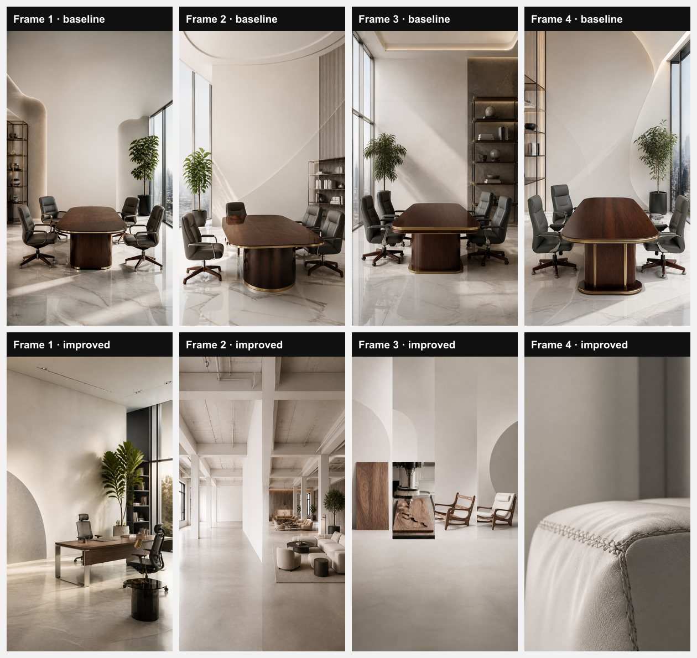

# Story comparison: baseline vs improved

Brand Creon Systems (ae6456b1-6e4f-4c82-8073-570c0b6c9449) · topic "Behind the scenes: turning a lounge sketch into a finished office lounge" · 4 frames · vibe none

| Frame | Baseline type + text + subtext | Improved type + text + subtext | Improved visual kind + must_show | Product reference used |
|---|---|---|---|---|
| 1 | *hook* (text top) **Ever wondered how a line on paper becomes a place people linger** We’re pulling the curtain on our latest office lounge | *hook* (text top) **From sketch to polished lounge** A Creon journey begins | **sketch_or_drawing**: A hand holding a hand‑drawn lounge sketch on a drafting table, pencil lines clear, shot from top‑down | baseline n / improved n |
| 2 | *reveal* (text center) **Sketch meets steel, wood, and light** The raw concept turns into a refined lounge space | *reveal* (text center) **Ready to see the final lounge?** A custom space, fully realized | **before_after**: Left side an empty office floor plan, right side the same space now furnished with a sleek lounge, frontal view | baseline n / improved n |
| 3 | *buildup* (text bottom) **Conceptual minimal versus finished elegance** Every joint, finish, and cushion calibrated for productivity and comfort | *buildup* (text bottom) **Rough sketch vs. refined lounge** Precision in every cut | **process_sequence**: Three sequential photos: walnut veneer sheet, CNC cutting machine, assembled lounge frame, arranged horizontally at eye level | baseline n / improved n |
| 4 | *cta* (text top) **Ready to see the full transformation** Visit our portfolio – link in bio @creonsystems | *cta* (text center) **Start your lounge transformation** Tap link to view portfolio | **detail_closeup**: Close‑up of a hand‑stitched leather cushion on the lounge, focus on stitching texture, soft ambient lighting | baseline n / improved n |

## Runs
### Baseline (5609923, pre-change story pipeline)
- Models: storyCopy = openai/gpt-oss-120b, imagePromptWriter = openai/gpt-oss-120b, image = gpt-image-2, imageQuality = low
- Total cost: $0.025244 (copy $0.001384, images $0.02386; prompt writer not priced)
- Total latency: 65.1 s (sequential; copy 3.9 s, prompt writer 0.9 s, images 60.2 s)
- Errors: 0

### Improved (main 2404015)
- Models: storyCopy = openai/gpt-oss-120b, imagePromptWriter = openai/gpt-oss-120b, image = gpt-image-2, imageQuality = low
- Total cost: $0.024306 (copy $0.002261, images $0.022045; prompt writer not priced)
- Total latency: 62.0 s (sequential; copy 6.5 s, prompt writer 1.1 s, images 54.4 s)
- Errors: 0

## Improved story plan
- **Goal:** Inspire viewers to imagine a custom office lounge and contact Creon Systems
- **Next action:** Tap the link to view the full project and request a design consult
  1. *hook* — From sketch to polished lounge
  2. *reveal* — Ready to see the final lounge?
  3. *buildup* — Rough sketch vs. refined lounge
  4. *cta* — Start your lounge transformation

Product reference: neither run had a product selected, so no frame used one.

## Brand state at improved run time
- Active lessons: unknown -- brand_lessons not readable (Could not find the table 'public.brand_lessons' in the schema cache) -- migration 059 not run, so no lessons could be used
- Brand Brain data: none
